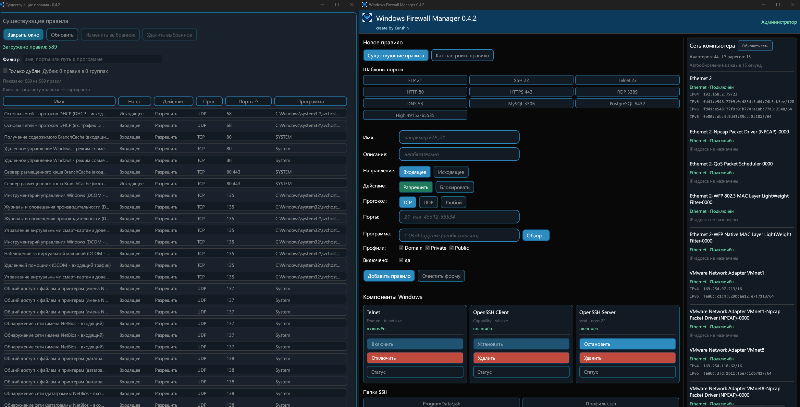

# Windows Firewall Manager

**Правила брандмауэра Windows, поиск дублей и сетевые адреса — в одном portable-приложении.**

[](https://github.com/kenshincheg/windows-firewall-manager/releases/tag/v0.4.2)


[](LICENSE)

Windows Firewall Manager — небольшая программа на Rust для управления правилами Windows Firewall на текущем компьютере. Помогает создать правило для порта или приложения, найти нужную запись, отредактировать выбранную копию и убрать дубли. Работает через Windows COM API; установка самой программы не требуется.

**[Скачать 0.4.2](https://github.com/kenshincheg/windows-firewall-manager/releases/tag/v0.4.2)** · [История изменений](docs/RELEASE_NOTES.md) · [Проверки](docs/TESTING.md) · [Сообщить об ошибке](https://github.com/kenshincheg/windows-firewall-manager/issues)



## Возможности

| Раздел | Что можно сделать |
|---|---|
| **Правила Firewall** | Добавить входящее или исходящее правило, выбрать разрешение/блокировку, протокол TCP/UDP/«Любой», программу, профили сети и состояние. |
| **Порты** | Указать один порт, диапазон, список через запятую или `*` для всех TCP/UDP-портов. |
| **Существующие правила** | Открыть отдельное окно, найти запись по имени, портам или пути программы, отсортировать список, изменить или удалить выбранную копию. |
| **Поиск дублей** | Показать все копии с совпадающими условиями, увидеть номера групп и удалить лишнюю строку, сохранив нужную. |
| **Шаблоны** | Подставить настройки FTP, SSH, Telnet, HTTP, HTTPS, RDP, DNS, MySQL, PostgreSQL и высоких портов. |
| **Сеть компьютера** | Посмотреть сетевые адаптеры, их состояние и назначенные IPv4/IPv6-адреса. Закреплённая панель обновляется каждые 15 секунд и вручную. |
| **Компоненты Windows** | Проверить состояние Telnet Client, OpenSSH Client и OpenSSH Server; использовать доступные действия установки, удаления и управления службой SSH. |
| **Справка и оформление** | Открыть отдельное окно «Как настроить правило», прочитать многострочные подсказки, работать в светлой или тёмной теме Windows. |

Список правил виртуализирован: при прокрутке рисуются видимые строки. Счётчики дублей вычисляются при загрузке, а подсказки строк создаются при наведении. Перемещение окна оптимизировано без затемнения формы.

## Быстрый старт

1. Скачайте **`WindowsFirewallManager-0.4.2-windows-x64.zip`** из [релиза 0.4.2](https://github.com/kenshincheg/windows-firewall-manager/releases/tag/v0.4.2).
2. Распакуйте в папку с правом записи, например `C:\Tools\WindowsFirewallManager`.
3. Запустите **`firewall_windows.exe`** и подтвердите запрос UAC.
4. Для просмотра нажмите **«Существующие правила»**; для создания заполните форму или выберите шаблон и нажмите **«Добавить правило»**.

Готовая сборка предназначена для **Windows 10 / 11 x64**. Rust для её запуска не нужен. Если Windows сообщает об отсутствии `VCRUNTIME140.dll`, установите [Microsoft Visual C++ Redistributable x64](https://learn.microsoft.com/en-us/cpp/windows/latest-supported-vc-redist/). Отрисовка использует DX12; при недоступности аппаратного рендеринга программа пробует программный WARP.

## Как пользоваться правилами

| Задача | Действие |
|---|---|
| Разрешить доступ к SSH-серверу | Выберите **SSH 22**, проверьте профиль сети и добавьте правило. Сам SSH-сервер должен быть установлен и запущен. |
| Настроить приложение | Выберите EXE кнопкой **«Обзор…»**, задайте направление, действие, протокол и профили. Для «Любой» оставьте порты пустыми. |
| Разрешить несколько портов | Для TCP или UDP укажите, например, `80,443` или `45000-45100`. |
| Изменить правило | Выделите строку и нажмите **«Изменить выбранное»** либо дважды щёлкните по строке. Изменения применяются кнопкой **«Сохранить»** в основной форме. |
| Убрать лишний дубль | Включите **«Только дубли»**, выберите лишнюю копию и нажмите **«Удалить выбранное»**. Затем список и группы обновятся. |

Программа управляет текущим компьютером. Для добавления, сохранения, удаления и изменения компонентов Windows нужны права администратора. Состояние прав видно в шапке; debug-сборка при необходимости предлагает перезапуск через UAC.

**Удаление выбранного правила выполняется сразу.** Автоматическое резервирование всей политики в программе пока не реализовано. Если нужна копия конфигурации перед изменениями, сохраните её из административной консоли:

```powershell
netsh advfirewall export "C:\Tools\firewall-backup.wfw"
```

## Как определяется дубль

Совпадения проверяются по направлению, действию, состоянию, исходному номеру протокола, профилям, программе, службе, локальным и удалённым IP/портам, интерфейсам, группе и дополнительным ограничениям Windows. **Одного одинакового имени недостаточно.** Имена и описания могут различаться.

Фильтр показывает все копии группы, включая первую. Номер в квадратных скобках перед именем связывает строки одной группы. Текстовый поиск работает вместе с режимом дублей.

Порядок элементов в списках IP/портов нормализуется; разные формы записи диапазонов автоматически не объединяются. Правила, параметры которых Windows не позволила прочитать полностью, не считаются дублями по неполным данным — их количество указано отдельно.

## Сохранение и ограничения

- При редактировании и удалении программа повторно проверяет снимок выбранной копии. Если правило изменилось извне, операция отклоняется с предложением обновить список.
- Несколько правил с одинаковыми именами обрабатываются адресно: редактируется или удаляется одна подходящая копия.
- ICMP и другие неподдерживаемые протоколы отображаются в списке, но ограниченная форма защищает их от редактирования как «Любой».
- Скрытое ограничение удалённых портов не снимается автоматически при выборе протокола «Любой».
- Валидация и предварительная проверка COM выполняются до изменения существующего правила. Windows применяет свойства по отдельности; это не общая транзакция для любых системных ошибок.
- Групповые политики и права доступа могут ограничить изменения. Установка компонентов Windows может потребовать перезагрузки.

## Данные и обновление

Папка `logs` создаётся рядом с EXE. В файле `firewall_ГГГГ-ММ-ДД.log` записываются действия и ошибки. Для обновления закройте программу и замените EXE, сохранив собственные журналы.

Сетевые адреса читаются локально через `GetAdaptersAddresses`; внешние сервисы определения IP не используются. Резервные копии конфигурации, личные журналы и локальные отчёты проверок не включены в исходники и release-архивы. Опубликованный скриншот приведён как пример интерфейса.

## Сборка и разработка

Нужны Windows x64, Rust MSVC и Visual Studio Build Tools с C++ и Windows SDK. Текущая версия проверена на **Rust 1.98.1**, target `x86_64-pc-windows-msvc`.

Из Developer PowerShell / x64 Native Tools Command Prompt:

```powershell
cargo build --release --locked
cargo test --locked
cargo clippy --all-targets --locked
```

EXE появится в `target\release\firewall_windows.exe`. Release-сборка содержит манифест `requireAdministrator`; debug-сборка не требует повышения для обычных тестов. Само приложение при запуске проверяет права и может предложить UAC.

Обычный `cargo test` не меняет рабочие правила Firewall. Реальные сценарии добавления/редактирования/удаления — отдельные игнорируемые тесты с явным режимом запуска и проверкой резервной копии. Подробности и границы проверки — в [TESTING.md](docs/TESTING.md).

В релизе приложены portable-архив, архив исходников и SHA-256. `BUILDINFO.txt` связывает EXE с версией и исходным коммитом. Автоматические исходные архивы GitHub также доступны рядом с релизом.

Для повторной упаковки нужен Python 3.11+ и чистый рабочий каталог после коммита:

```powershell
python scripts/package_release.py
```

Файлы появятся в `target/publication/artifacts`. Упаковщик проверяет архитектуру EXE и контрольную сумму внутри ZIP, а исходный архив создаёт из Git-коммита. Перед упаковкой соберите EXE из этого же коммита; упаковщик сам программу не компилирует.

## Обратная связь и лицензия

[Issues](https://github.com/kenshincheg/windows-firewall-manager/issues) — для ошибок и предложений. Укажите версию программы, сборку Windows и шаги воспроизведения; перед отправкой журнала проверьте его содержимое.

**Автор: Kenshin** · [MIT](LICENSE) · [Журнал разработки](https://github.com/kenshincheg/windows-firewall-manager/blob/main/DEVLOG.md)
